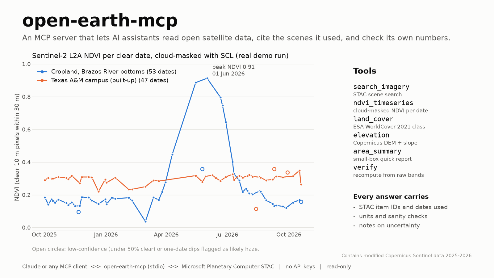
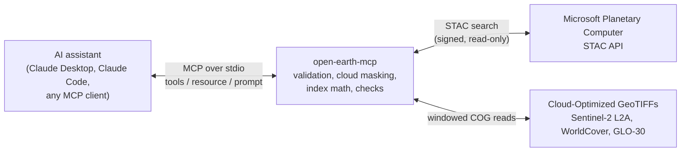

# open-earth-mcp

**open-earth-mcp** is a [Model Context Protocol](https://modelcontextprotocol.io) server that gives an AI assistant (Claude Desktop, Claude Code, or any MCP client) read-only access to open Earth-observation data: Sentinel-2 imagery, ESA WorldCover land cover and the Copernicus 30 m DEM, all from Microsoft Planetary Computer with no API keys. Every answer returns the STAC item IDs and dates it used, its units, a set of sanity checks and plain-language caveats, and a `verify` tool recomputes key values through a second code path. The assistant can show where each number came from and say when the data is uncertain, so it does not have to guess.





## Tools

| Tool | What it returns | Data |
|---|---|---|
| `search_imagery(start, end, bbox \| lon+lat, collection, max_cloud, limit)` | Scenes covering a place and date range, newest first: ID, time, cloud cover, tile | Sentinel-2 L2A or Landsat C2 L2 |
| `ndvi_timeseries(lon, lat, start, end, buffer_m=30)` | NDVI for each usable date: mean, std, clear-pixel count, clear fraction, `low_confidence` and `suspect_dip` flags; fully cloudy dates are listed under `skipped` | Sentinel-2 L2A B04/B08 + SCL mask |
| `land_cover(lon, lat, buffer_m=0)` | WorldCover class at the point; with a buffer, the share of each class | ESA WorldCover 2021 v200 (10 m) |
| `elevation(lon, lat)` | Elevation (m, EGM2008), slope (Horn 3x3), local relief | Copernicus DEM GLO-30 |
| `area_summary(bbox, days_back=90)` | Small-box report (max 25 km²): land-cover shares, elevation and slope stats, NDVI of the latest scene that is at least 60% clear | all three |
| `verify(lon, lat, days_back=120)` | Independent checks with status `pass` / `warn` / `fail`: recomputes NDVI from raw bands, compares native and regridded elevation and land cover, and compares land cover with NDVI | all three |

The server also offers:

* **Resource** `catalog://collections`: the supported collections, their resolution, license and required attribution.
* **Prompt** `describe_place(lon, lat)`: a template that calls the tools in order, runs `verify` and asks for an answer with sources and caveats.

## Install

```bash
git clone https://github.com/landon2199/open-earth-mcp.git
cd open-earth-mcp
conda env create -f environment.yml      # GDAL/rasterio come from conda-forge
conda activate open-earth-mcp
pytest                                   # offline unit tests
pytest -m network                        # one live test against Planetary Computer
python examples/demo_client.py           # full stdio demo, writes examples/demo_output.md
```

If you already have a geospatial environment, use `pip install -e .` instead. Python 3.11 or later and the MCP Python SDK 2.x are required. The server is built on `mcp.server.mcpserver.MCPServer`.

## Register with an MCP client

**Claude Code**

```bash
claude mcp add open-earth -- /path/to/envs/open-earth-mcp/bin/python -m open_earth_mcp.server
# or, with the env on PATH:
claude mcp add open-earth -- open-earth-mcp
```

**Claude Desktop** (`claude_desktop_config.json`)

```json
{
  "mcpServers": {
    "open-earth": {
      "command": "C:\\Users\\<you>\\miniforge3\\envs\\open-earth-mcp\\python.exe",
      "args": ["-m", "open_earth_mcp.server"]
    }
  }
}
```

Use the full path to the environment's interpreter, because MCP clients start the server without activating conda. On Windows the package puts the environment's own DLL folder first on `PATH` when it starts, so numpy and GDAL do not load incompatible system DLLs.

## Example: question, tool call, answer

All values below come from the run recorded in [`examples/demo_output.md`](examples/demo_output.md) (22 Oct 2026).

> **Q:** *"When did the crop field in the Brazos River bottoms west of Bryan (lon -96.5733, lat 30.6805) green up this year, and how sure are you?"*

1. `land_cover(-96.5733, 30.6805, buffer_m=200)` → **Cropland**: 100% of 1,257 WorldCover pixels within 200 m.
2. `ndvi_timeseries(-96.5733, 30.6805, "2025-10-01", "2026-10-22", buffer_m=30)` → **53 clear dates** (12 cloudy dates skipped). NDVI rose from 0.18 (13 Mar) to 0.45 (10 Apr, 62% of pixels clear) and 0.89 (15 May), and **peaked at 0.91 on 1 Jun 2026** (scene `S2A_MSIL2A_20260601T170711_R069_T14RQV_…`, 29 of 29 pixels clear). By 19 Jul it had fallen to 0.29, which looks like harvest. The 0.36 value on 25 May is flagged `suspect_dip`: it sits between 0.89 and 0.91 and only 69% of the pixels were clear, so it is more likely missed haze than a real change.
3. `verify(-96.5733, 30.6805)` → **status `pass`, 6/6 checks**. NDVI for 17 Oct 2026 from the pipeline was 0.1685; reading the raw B04/B08/SCL bands on the scene's own grid gave 0.1683 (|Δ| = 0.0002). Native elevation was 76.16 m and the regridded value 76.12 m.

> **A (as the assistant should phrase it):** "The field greened up between early April and mid-May; there is no clear scene between 10 April and 15 May, so the exact timing is uncertain. NDVI went from 0.18 on 13 March to 0.45 on 10 April and 0.89 by 15 May and peaked at 0.91 on 1 June 2026 (Sentinel-2 scene S2A…20260601, fully clear), then dropped to 0.29 by 19 July, which fits a harvest. One low reading on 25 May is probably haze, not crop change. An independent recompute agreed within 0.001 NDVI."

More numbers from the same run:

| Call | Result |
|---|---|
| `elevation(-96.3365, 30.6187)` (Texas A&M campus) | 107.8 m (EGM2008), slope 2.77°, relief 8.7 m in a 150 m window; native vs regridded 107.8 / 107.4 m |
| `land_cover(-96.3365, 30.6187, 200)` | Built-up at the point; within 200 m: 68.1% built-up, 25.1% grassland |
| `area_summary([-96.36, 30.60, -96.32, 30.63])` | 12.8 km²: 60.2% built-up, 19.5% grassland, 18.6% tree cover; elevation 87.6–131.0 m (mean 102.2); NDVI 0.35 (median 0.33) on 19 Oct 2026, 64.7% of the box clear |
| `verify(-96.3365, 30.6187)` (campus) | `pass` 5/5; NDVI 0.3486 from the pipeline vs 0.3342 from the independent read (|Δ| 0.014, within the 0.03 tolerance; a mixed built-up pixel window is sensitive to grid alignment) |
| `area_summary` with a 1.5° × 1° box | Refused: "bbox covers about 15980.0 km^2; the limit is 25 km^2 …" |
| `ndvi_timeseries` with lon and lat swapped | Refused: "lat=-96.3365 is outside [-90, 90]. Did you swap lon and lat?" |

## Design notes

**Traceability.** Every response includes `sources`: the STAC API, the collection, the exact item IDs and the acquisition dates. Units appear in key names (`elevation_m`, `buffer_m`) or in a `units` block. The server's MCP `instructions` tell the assistant to cite them.

**Verification.** Checks run at two levels.
* *Inline `checks`* in every tool, for example: NDVI within [-1, 1], clear-pixel count > 0, class shares summing to 100%, every scene's processing baseline known, scaled B04/B08 reflectance inside a plausible range ([-0.02, 1.2]; a wrongly applied -1000 offset drives dark pixels below it), and native vs regridded values within tolerance.
* *`verify`* re-derives values through a second, simpler path that reads the native pixels directly with rasterio (no odc-stac and no reprojection) and compares them with the main pipeline. It also checks land cover against NDVI: a vegetated class should have NDVI above 0.1, and water should be below 0.2. A mismatch returns `warn` and an explanation (for example change since 2021 or a class edge); the server does not choose one answer for you.

**Stating uncertainty instead of guessing.** Cloudy dates are skipped and listed, not filled in. Partly cloudy dates are flagged `low_confidence`, and one-date dips that recover on the next date are flagged `suspect_dip`. The notes say what each dataset can't tell you: WorldCover shows 2021 and has about 77% overall accuracy, and GLO-30 is a surface model that measures roof and canopy heights.

**Sentinel-2 details that are easy to get wrong.** Since processing baseline 04.00 (January 2022), L2A digital numbers carry a +1000 offset. The server reads `s2:processing_baseline` for each scene and subtracts the offset before computing NDVI. Without this step NDVI is biased low (see `tests/test_offline.py::test_offset_changes_ndvi`). Where two MGRS tiles overlap the point, the same-day scenes are loaded separately, each is scaled to reflectance with its own offset, and only then are they mosaicked. A day that mixes baselines (possible around the January 2022 switch) is therefore still correct, is named in the notes, and is covered by a synthetic test (`test_mosaic_mixed_baselines_scales_each_scene`). Across the switch at the campus point, NDVI stays continuous: 0.27 on 21 Jan 2022 (baseline 03.00) and 0.26 on 26 Jan 2022 (04.00). Clouds are masked with the Scene Classification Layer, keeping only vegetation, not-vegetated and water. Snow/ice pixels are excluded from NDVI and counted per date as `snow_pixels`; land cover and elevation do not use SCL.

**Guardrails.**
* lon/lat ranges are validated, with a hint when lon and lat look swapped.
* bbox must be at most 25 km², and buffers at most 500 m.
* Date ranges must be in order, end on or after 23 Jun 2015 (Sentinel-2A launch), span at most 2 years and not start in the future.
* Collections must be on an allow-list.
* Each tool call times out after 120 s, and GDAL HTTP has its own timeouts and retries.
* Every tool is annotated `readOnlyHint`, and nothing is written.
* No arbitrary URLs: only the fixed STAC endpoint is queried, and asset links are opened only if they are HTTPS on Planetary Computer storage (`*.blob.core.windows.net`).
* Errors come back as short messages the assistant can relay.

**Limits.** Calls are made to stay fast: point windows of a few pixels, 20 m for box NDVI. A one-year NDVI series takes about 20–55 s and the other tools take 1–12 s. Results depend on the public Planetary Computer service and its signed-URL tokens. NDVI is a top-of-canopy greenness index, not a crop-yield or biomass estimate. Land cover is for 2021.

## Project layout

```
open_earth_mcp/
  server.py       MCP server: tools, resource, prompt, timeouts, error mapping
  data.py         STAC search + COG reads, sources/checks/notes for each tool, verify
  science.py      NDVI, Sentinel-2 offsets, SCL mask, WorldCover classes, Horn slope (pure numpy)
  validation.py   input guardrails (pure Python)
examples/
  demo_client.py  launches the server over stdio with the MCP client SDK and calls every tool
  demo_output.md  transcript of the real run quoted above
  demo_ndvi.json  full NDVI series from that run (used for the hero image)
docs/
  make_hero.py    builds docs/hero.png from demo_ndvi.json
tests/
  test_offline.py unit tests (validation, index math, MCP surface)
  test_network.py live integration test (pytest -m network)
```

## Data licenses and attribution

| Data | License / terms | Attribution |
|---|---|---|
| Sentinel-2 L2A (Copernicus) | [Copernicus Sentinel data legal notice](https://sentinels.copernicus.eu/documents/247904/690755/Sentinel_Data_Legal_Notice): free, full and open | "Contains modified Copernicus Sentinel data [year]" |
| ESA WorldCover 2021 v200 | [CC BY 4.0](https://creativecommons.org/licenses/by/4.0/) | "© ESA WorldCover project 2021 / Contains modified Copernicus Sentinel data (2021) processed by ESA WorldCover consortium" |
| Copernicus DEM GLO-30 | [Copernicus DEM licence](https://spacedata.copernicus.eu/documents/20126/0/CSCDA_ESA_Mission-specific+Annex.pdf): free use with attribution | "© DLR e.V. 2010-2014 and © Airbus Defence and Space GmbH 2014-2018 provided under COPERNICUS by the European Union and ESA; all rights reserved" |
| Landsat Collection 2 (search only) | Public domain, USGS | "Landsat imagery courtesy of the U.S. Geological Survey" |
| Access platform | [Microsoft Planetary Computer terms of use](https://planetarycomputer.microsoft.com/terms-of-use) | n/a |

The same information is available to the assistant at runtime through the `catalog://collections` resource.

## License

Code: [MIT](LICENSE) © 2026 Landon Melesky. The data keeps its own licenses (see above).
